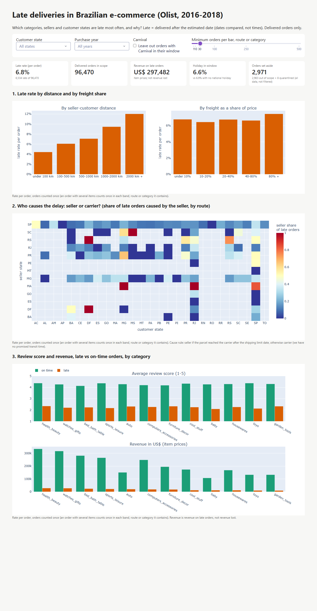

# Olist late-deliveries pipeline

DSC 620 Data Engineering, Lebanese American University (instructor: Ahmad Audi). Topic T8.
Team: Nancy Kalmiche (202507819) and Jason Greich (202507818).

## The question

**Which product categories, sellers and customer states have the highest late-delivery rate per order, do seller-to-customer distance and freight cost explain it, and do national holidays make it worse?**

Two extra questions:
- **Seller or carrier?** For each seller-state to customer-state route, is the delay caused by the seller (handoff after the shipping limit date) or by the carrier (transit after handoff)?
- **Cost of lateness:** how much lower is the review score on late orders, and how much revenue (USD) sits on late orders? (We say "revenue on late orders", never "revenue lost".)

Primary user: an online store's logistics team deciding which sellers, categories and routes to act on.



## Sources

| Source | Type | Link | Terms |
|---|---|---|---|
| Olist Brazilian e-commerce (9 tables, 2016-2018) | database (SQLite store, extracted with SQL) | [Kaggle: olistbr/brazilian-ecommerce](https://www.kaggle.com/datasets/olistbr/brazilian-ecommerce) | CC BY-NC-SA 4.0. **Not committed to this repo.** |
| Nager.Date public holidays, Brazil | API | https://date.nager.at/api/v3/PublicHolidays/{year}/BR | free, no key |
| Frankfurter v2 exchange rates, BRL to USD (ECB data) | API | https://api.frankfurter.dev/v2/rates | free, no key |

## Run it from a fresh clone

Needs Python 3.13 (3.11 or 3.12 should also work; the pinned versions were tested on 3.13).

```powershell
git clone https://github.com/JasonGreich/DE_Final.git
cd DE_Final
python -m venv .venv
.venv\Scripts\activate          # Linux/macOS: source .venv/bin/activate
pip install -r requirements.txt   # takes a few minutes (dbt)
```

**Get the Olist data** (pick one):
1. Download `brazilian-ecommerce.zip` from Kaggle and put the zip (or the 9 CSV files) in `data/seed/`. No account settings needed beyond the download.
2. Or copy `.env.example` to `.env`, fill in `KAGGLE_USERNAME` and `KAGGLE_KEY` (Kaggle > Settings > API), and the pipeline downloads it for you.

```powershell
python run_pipeline.py          # first run: builds data/store/olist.db, extracts everything, tests, dbt, load checks (about 40 s)
python dashboard/app.py         # then open http://127.0.0.1:8050
python -m pytest -q             # about 90 s, uses an invented fixture, no real data or internet needed
```

Options: `python run_pipeline.py --full` (ignore the watermark; also enables the 90,000-row test), `--as-of 2017-06-30` (only orders up to that date, to demo two incremental runs).
A second run changes nothing (see `docs/idempotency_proof.txt`). Every run writes `logs/pipeline_<timestamp>.log` and a row in the `run_log` table.

Optional extras: `python -m src.report_numbers` (rewrites `docs/report_numbers.json`) and `python -m src.load.idempotency_proof` (runs the pipeline twice and compares checksums).

### dbt

`run_pipeline.py` calls dbt for you (step 4 of 5). To run it by hand, after the pipeline has staged the data:

```powershell
cd dbt_project
$env:WAREHOUSE_PATH = (Resolve-Path ..\data\warehouse\warehouse.db).Path
$env:WAREHOUSE_DIR  = (Resolve-Path ..\data\warehouse).Path
dbt build --profiles-dir .      # builds dim_*, fact_order_item and the vw_* views, then runs 33 tests
```

dbt uses the community `dbt-sqlite` adapter on SQLite (decision and caveats in `docs/decisions.md`). No `dbt deps` is needed: there are no packages.

### GitHub Actions

- `ci.yml`: on every push, installs the requirements and runs pytest (including a small end-to-end pipeline run on the fixture).
- `schedule.yml`: daily at 05:00 UTC and on manual dispatch. It needs two repository secrets: in GitHub open **Settings > Secrets and variables > Actions > New repository secret** and add `KAGGLE_USERNAME` and `KAGGLE_KEY`. The run uploads the warehouse and logs as an artifact. The Olist data is static, so a scheduled run is an idempotent re-run that still writes a `run_log` row.

## Repository layout

```
run_pipeline.py        one command for everything
src/extract/           olist.py nager.py frankfurter.py seed_store.py manifest.py watermark.py http.py
src/transform/         staging.py geo.py rules.py        (pandas: cleaning, haversine, business rules)
src/quality/           tests.py quarantine.py            (15 data tests, quarantine tables)
src/load/              load_warehouse.py run_log.py checksums.py idempotency_proof.py
src/report_numbers.py  writes docs/report_numbers.json
dbt_project/           models (marts, views), schema.yml tests, sources.yml
dashboard/app.py       Dash dashboard (reads the vw_ views only)
tests/                 pytest, with an invented fixture in tests/fixtures/
docs/                  architecture, schema, business_rules, profiling, decisions, code_walkthrough, AI_USAGE, report_numbers.json
.github/workflows/     ci.yml schedule.yml
data/                  seed/ store/ raw/ warehouse/   (git-ignored, never committed)
```

## Documentation

`docs/architecture.md` (layers and who does what), `docs/schema.md` (star schema), `docs/business_rules.md` (BR1-BR4 with examples), `docs/profiling.md` (real data quirks), `docs/decisions.md`, `docs/code_walkthrough.md`, `docs/AI_USAGE.md` (what was generated by AI and what humans must review).
