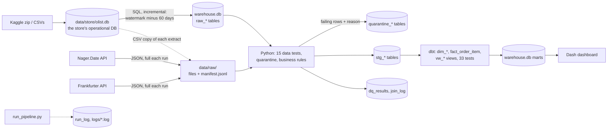

# Architecture

## Who does what

| Layer | Tool | What it does |
|---|---|---|
| Store | `src/extract/seed_store.py` | Loads the 9 Olist CSVs into SQLite `olist.db`, which plays the store's operational database. |
| Extract | `src/extract/olist.py` (SQL), `nager.py`, `frankfurter.py` | Olist orders (with items and reviews) are read by `order_purchase_timestamp` from `watermark - 60 days`, upserted by key into `raw_*`; the small dimension tables and the two APIs are re-read in full. Every extract is saved untouched in `data/raw/` and listed in `manifest.jsonl`. The watermark is in `extract_state`. |
| Quality + quarantine | Python (`src/quality`) | 15 tests; rows that fail a quarantine-level test move to `quarantine_*` with a reason; stop-level tests abort. |
| Staging (pandas) | `src/transform` | Cleaning, geolocation to one centroid per zip prefix, haversine distance, BR1-BR4 flags, one review per order, checked joins, reconciliation. Writes `stg_*`. |
| Marts | **dbt** (`dbt_project/`) | Builds `dim_date` (with holidays and forward-filled rates), the other dimensions, `fact_order_item`, and the views. Runs 33 YAML and SQL tests. |
| Orchestration | `run_pipeline.py` | Runs the steps in order, logs, writes `run_log`, exits non-zero on failure. |
| Serving | `dashboard/app.py` | Reads only the `vw_*` views. |

Why the split: quarantine and the business rules need row-level logic with reasons and unit tests, which is easier in Python. The star schema and its tests are declarative SQL, which suits dbt. dbt starts from the `stg_*` tables (`source()`), so the Python quarantine is not repeated in dbt.

## Idempotency and incremental behaviour
- Orders in the overlap window are replaced by key (never appended twice); their items and reviews are replaced as a group.
- `stg_*`, `quarantine_*`, `dim_*`, `fact_*` are rebuilt from the same inputs each run (one transaction for staging), so a second run gives identical row counts and checksums.
- `dq_results`, `join_log`, `run_log`, `extract_state` are history tables and grow by design.

## Scheduling, honestly
The Olist data is a static 2016-2018 snapshot. A daily scheduled run therefore finds nothing new: it is an idempotent re-run that proves the pipeline still works and still writes a `run_log` row. The incremental logic is demonstrated with `--as-of` and with the integration test that changes an order in `olist.db`.

## Known limits
- dbt-sqlite is a community adapter; if it breaks, the plan in `docs/decisions.md` is to move the marts to DuckDB.
- The "carrier" cause means "the seller was on time, so the delay was in transit": there is no promised carrier transit time in the data.
