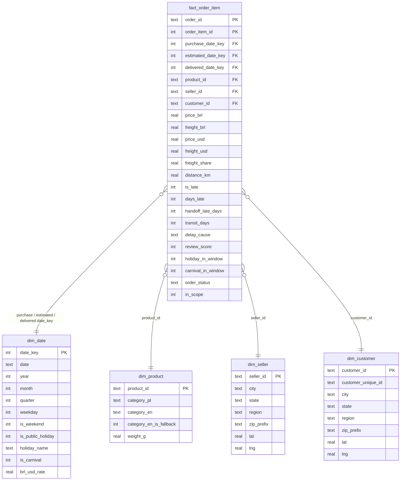

# Star schema (SQLite warehouse)

## Grain and why
**One row per order item** (`order_id`, `order_item_id`). Seller, product, price, freight and shipping limit belong to the item, and an order can have items from several sellers and categories, so the item is the lowest level that keeps all of them without losing detail.

The cost: order-level facts (dates, review score, holiday flags, `is_late`) are repeated on every item. **Counting rows would overcount orders** (per item the late rate is 6.59%, per order 6.77%). Every rate therefore uses `count(distinct order_id)`, and the views (`vw_order_late`, `vw_chart_*`) do this for you.

## dim_date is role-playing
The three date keys in the fact table all point to `dim_date`. It is also where holidays and exchange rates meet the facts: `is_public_holiday`, `holiday_name`, `is_carnival`, and `brl_usd_rate` (the ECB rate, forward-filled over weekends and ECB holidays: a weekend uses the Friday rate).

## Views (order level)
- `vw_order_late`: one row per in-scope order; the base of every rate.
- `vw_chart_distance_freight`, `vw_chart_route_cause`, `vw_chart_category_cost`: one per dashboard chart. They keep state, year and holiday flags as columns so the dashboard can filter and then add order counts.
- `vw_data_health`: orders set aside, for the dashboard header.

## Other warehouse tables
`raw_*` (extracts), `stg_*` (staged), `quarantine_*`, `dq_results`, `join_log`, `extract_state`, `run_log`.
